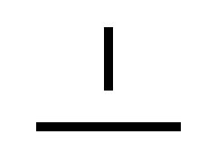
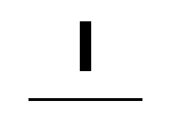

# A2: affine path strokes

This change fixes positive-width page-path strokes under nonuniform scale,
rotation, reflection and shear. Previously the collector averaged the CTM's
basis-vector lengths into a scalar width/dash scale, and SVG multiplied those
metrics by the output scale again even though the path already had a scale
transform.

`PdfPathItem.stroke` now retains the stroke-local path, its full affine mapping
to unscaled SVG page space, original width/dash metrics and PDF miter limit.
The SVG backend keeps that transform on the stroke. Fill geometry, clipping
and soft-mask wrappers remain in page space; stroke pattern coordinates cancel
the stroke-local transform before applying the existing pattern transform.
The original page-space fields remain available. Code constructing a
`PdfPathItem` directly must add `stroke: None` to select the legacy representation.
No codec, dependency version, text/font handling or collector CTM behavior changed.

## Checks

- `moon info && moon fmt`
- `moon test --target wasm`, `wasm-gc`, `js`, `native`: **226/226 on each target**
- `moon check --target all`
- `moon build --target js --release cmd/browser`
- `moon build --target native cmd/main`
- `git diff --check`

Five new white-box regressions exercise raw pen metrics, full affine matrices,
page origins/reflection/rotation, clip coordinates, default/ExtGState miter
limits and stroke-pattern compensation. The existing manually constructed path
fixture receives only the new optional field. Compiler deprecation warnings
are pre-existing (24 warnings); the new type adds none.

## Rendered evidence

Generate the original, Apache-2.0 test PDF and 132 SVG exports with:

```sh
moon run tools/affine_strokes.mbtx _build/affine-strokes
```

The exporter builds this checkout's existing JS bridge, then renders 11 pages
at scales 0.5, 1 and 2, with rotations 0, 90, 180 and 270. It only exports;
successful export is not a pixel comparison. The PDF SHA-256 is
`2a6bd1204da7ecbec22c1714e69c8f4adf2488c8dc2c3996c9eb5c6180dc200d`.

A one-off Node diagnostic rasterized the before/after SVGs with resvg 2.6.2 and
the same PDF with PDF.js 6.4.299 / @napi-rs/canvas 1.0.10, on white, with Node
v24.19.0. The baseline is commit `7ab1cec`. These are different rasterizers;
this is **not** a rerun of the repository-pinned PDF.js 6.5.0 Chromium suite.
No pages were skipped or resized and the per-channel tolerance remained 8.
[All 132 measurements and the two real-fixture results](affine-strokes.json)
record the remaining differences.

Across 9,979,200 compared pixels, the count above tolerance fell from
829,167 to 138,922. This is an error count over this fixture set, not a PDF
compatibility score. The nonuniform-width page is pixel-identical in all 12
variants (52,440 differences before, zero after), including independent checks
of the horizontal/vertical ink bounds. The page-space clip's outside region
also remains empty at every scale/rotation.

At scale 1, rotation 0:

| Fixture | Before, pixels >8 | After, pixels >8 |
| --- | ---: | ---: |
| Nonuniform width | 1,380 | 0 |
| Dash phase, round caps/joins | 2,018 | 554 |
| Sheared curves | 1,103 | 232 |
| Page-space clip | 2,985 | 306 |
| Mixed `cm` compatibility probe | 913 | 219 |
| `Q` compatibility probe | 2,488 | 2,488 |
| Pre-paint `cm` compatibility probe | 1,700 | 0 |
| Miter limits | 1,026 | 282 |
| Fill and stroke | 1,568 | 475 |
| Reflection/nonzero page origin | 1,247 | 147 |
| Tiling-pattern stroke | 4,692 | 3,284 |

The three compatibility probes put graphics-state operators inside an active
path. They remain diagnostic inputs; this PR leaves that recovery behavior
unchanged and does not claim conformance or a fix for the `Q` discrepancy.
Residual differences on the regular fixtures remain recorded, including the
pattern case; they are not automatically attributed to antialiasing. In the
pattern probe, the reference stripes stay page-vertical while the existing
viewer pattern mapping shears them with the CTM. The stroke compensation
preserves that existing mapping; pattern-space anchoring remains incorrect.

Unedited raster outputs for the nonuniform-width page, at scale 1:

Before:



After:



PDF.js reference:


Two real PDFs from the existing pinned upstream revision
`89b500f5e1d98ed89bb90211e45b28730b2d99ac` were also measured at page 1,
scale 1. `issue19176.pdf` retains matching 612×792 dimensions and zero pixel
differences. `tiling_patterns_variations.pdf` retains matching 600×800 dimensions
and 19,046 pixels above tolerance, unchanged from baseline. These selected
checks do not replace the full corpus. Their source hashes are in the JSON.

## Remaining boundaries

Zero-width hairlines, singular CTMs, deferred `W`/`W*` clipping and winding
rules, affine strokes inside pattern cells, shading-pattern strokes, and full
transparency-group fidelity remain separate work. JPEG/SMask/Matte and other
codec gaps are untouched. No broad TODO item is marked complete.
