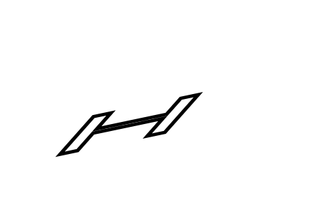

# Bundled Standard 14 and independent affine text pens

Validated 2026-10-11 using A1 font/text source `a22a190` integrated with A2's
Canvas plan and independent affine pen. This record covers the default bundled
font path; the [Oct 10 native-host adapter experiment](host-text-pen.md#historical-native-host-validation-2026-10-10)
retains its original measurements and a different font-acquisition boundary.

## Entry point, fixture, and provenance

The test uses the actual shipped `web/_generated/pdf.js` public `open_pdf` /
`render_page` bridge and `web/pdf-runtime.mjs::renderPdfPage`. The measured
bridge SHA-256 is
`09a64b9bc4c0575b1cab462b6dabb4cc9d0a780fc99d6bd61e36faf4f765e215`.
It runs in `@napi-rs/canvas` 1.0.10 with **no native text-outline resolver and no
host font registration**. For the actual and embedded-control replay, even
loading an SVG/image fallback throws an error, so success cannot conceal a
host-font substitution.

The original `tools/text_host_pen.mbtx` fixture remains **621 bytes**, SHA-256
`faf86fff67b17f2d78afcf5353341c85b5949e560a11c5271166432e5193a538`.
It is a 240 by 160 point PDF with unembedded Helvetica, a graphics CTM and an
independent anisotropic/sheared text matrix:

```text
q 1.1 .15 .2 .85 15 20 cm 3 w 0 J 0 j 4 M
BT /F1 60 Tf 1 Tr 2 .2 .4 .7 10 30 Tm (H) Tj ET Q
```

The default Helvetica program is A1's bundled Liberation Sans TrueType, SHA-256
`f8ace1f892b2bd9dc1792ba7f097fa7588f84fed48321480e04de5390828221f`.
The test checks its bytes and hash against the
[Standard 14 inventory](../../assets/standard14/inventory.json), then generates
an embedded control with exactly those font bytes. Embedded-control PDF SHA-256
is `25fc97c8caa8fdd259fb0a610f92b8699b619da924482a7d06c69d81205fe079`.
Font provenance and redistribution terms are preserved in
[the Standard 14 asset documentation](../../assets/standard14/README.md).
The pinned PDF.js source is `89b500f5e1d98ed89bb90211e45b28730b2d99ac`.

The harness changes only the single-byte `Tr` value to exercise modes 0 (fill),
1 (stroke), and 2 (fill and stroke), preserving each PDF's length and xref.
Every mode runs at scales 1 and 2 and rotations 0, 90, 180, and 270 degrees:
**24 strict replay cases** in total.

## Acceptance and measured results

All 24 cases pass with:

- Zero plan and replay diagnostics, and nonblank actual/control output.
- No `text_svg` host primitive. Bundled glyphs use the existing A1 contours.
- Identical A1 bundled/embedded glyph transforms, advance, fill paths and stroke
  records, including the independent pen matrix and width.
- Exact same-font embedded-control RGB pixels: MAE **0**, maximum channel
  difference **0**, and zero pixels with a channel difference above 8.
- PDF.js-matching viewport dimensions and an unchanged source plan after replay.

The retained graphics pen has width 3 and transform
`[1.1, -0.15, -0.2, 0.85, 15, 140]`; it does not take a similarity-transform
shortcut. Exact same-font equality is the acceptance oracle. Cross-renderer
measurements below are reported separately, without expanding a tolerance to
make them pass.

An independent path-only PDF is generated from the **existing embedded A1
control**, rather than from the bundled path under test. It retains the same
pen and replaces H with explicit line contours. Poppler 26.05.0 and Ghostscript
10.05.1 render this geometry control. The original text PDF is also measured
with PDF.js 6.4.299 and Poppler, without assuming identical glyph/rendering
policy. Each range below spans the eight scale/rotation combinations for that
mode; values are RGB MAE on a 0–255 scale.

| Comparison | Stroke (`Tr 1`) | Fill (`Tr 0`) | Fill and stroke (`Tr 2`) |
| --- | ---: | ---: | ---: |
| Same-font embedded A1 | **0.000000** | **0.000000** | **0.000000** |
| Explicit path / Poppler | 0.139427–0.276693 | 0.073835–0.164453 | 0.069010–0.162604 |
| Explicit path / Ghostscript | 0.287005–0.570234 | 0.165645–0.345469 | 0.165749–0.348828 |
| Original text / PDF.js | 2.013118–2.135417 | **0.000000** | 1.054232–1.114974 |
| Original text / Poppler | 6.100547–6.129688 | 5.115339–5.156302 | 6.668353–6.716667 |

The path-only controls retain antialiasing/rasterization residuals. Original
text measurements retain font and text-rendering-policy differences, including
the remaining stroke differences against PDF.js. The zero-difference fill
case is this fixture's measurement, not a claim about all Standard 14 glyphs or
arbitrary documents. All per-case maximum errors, pixels above 8, ink counts,
hashes and tool versions are in [standard14-pen.json](standard14-pen.json).
That portable report is copied from the generated report with only its bridge
path made repository-relative.

The common check also builds `cmd/main`, exports the unchanged PDF through its
public `.canvas.json` CLI, then invokes `tools/render_canvas.mjs`. Its 240×160
RGBA output is byte-identical to the default web result; the saved plan already
contains the bundled stroke contours before any optional host callback. This
check is enabled by `PDF_NATIVE_PLAN` in `tools/a2_check.mbtx` and recorded as
`nativePublicEntry` in the JSON evidence.



## Explicit host overrides and remaining boundary

The public `set_font_fallbacks` override still wins when deliberately selected.
For `/F1` with family `Liberation Sans`, the test verifies that the selected
family is retained, the bundled stroke path is absent, and the independent
pen records `affine-text-pen-requires-glyph-outline`. Without a capable outline
callback, strict replay rejects `PDF_TEXT_STROKE_GEOMETRY`.

Clearing the override with `set_font_fallbacks('[]')` invalidates the page cache,
restores the bundled stroke contour, and immediately returns to strict,
nonblank rendering with zero diagnostics. The companion
[`text_diagnostic_test.mjs`](../../tools/pixels/text_diagnostic_test.mjs)
explicitly selects the host override and verifies the warned preview plus the
page/thumbnail alert binding using an element double.

Nonstandard fallback text without usable A1 contours retains the same host
outline requirement for independent non-similarity strokes. Ordinary Canvas text metrics or a family name do not
provide glyph outlines. The optional
[native host adapter](host-text-pen.md) remains available for capable hosts.
This validation changes neither that boundary nor the declared approximation
of legacy standalone SVG output.

## Evidence limits

This is shipped web bridge/runtime execution in a native Canvas API host.
Chromium could not launch because socket creation was denied with EPERM;
**no browser DOM, selection, interaction, or browser screenshot pass is
claimed**. No native-only outline callback or font registration is being used
to stand in for the default bundled path.

The new acceptance matrix isolates Helvetica H under the stated affine matrices
and three paint modes. Broader Standard 14 parsing, encoding, clipping and font
coverage belong to [A1's font validation](../validation.md#standard-14-fonts-and-host-fallback).
These 24 cases are not a visual compatibility percentage, an entire-corpus
pass, or a replacement for final merged-tree aggregate checks.

## Reproduction

Run from the repository root with the MoonBit toolchain on `PATH`, Node, Poppler
(`pdftoppm`) and Ghostscript (`gs`). Use an installed host package containing
`@napi-rs/canvas` 1.0.10 and `pdfjs-dist` 6.4.299; the PDF.js renderer is a test
reference. The separate locked asset dependencies use `pdfjs-dist` only for
standalone JBIG2 Wasm. The normal fresh-checkout build prerequisites
are described in [native Canvas setup](native-canvas-setup.md).

```sh
npm ci --prefix tools/web-assets --ignore-scripts --omit=optional
moon run tools/build_web.mbtx
PDF_CANVAS_PACKAGE=/absolute/path/to/canvas-host/package.json \
  node tools/pixels/standard14_pen_test.mjs web/_generated/pdf.js \
  _build/text-host-pen _build/standard14-pen
PDF_CANVAS_PACKAGE=/absolute/path/to/canvas-host/package.json \
  node tools/pixels/text_diagnostic_test.mjs web/_generated/pdf.js
```

The first test generates the unchanged fixture and exact-font embedded control
itself. It writes per-mode PDFs, path controls, Canvas plans, actual/reference
PNGs and `_build/standard14-pen/report.json`. The second exercises the explicit
host-override warning boundary. Rebuild and record a new bridge hash when the
source changes; do not attribute this report to an unmeasured bridge.
